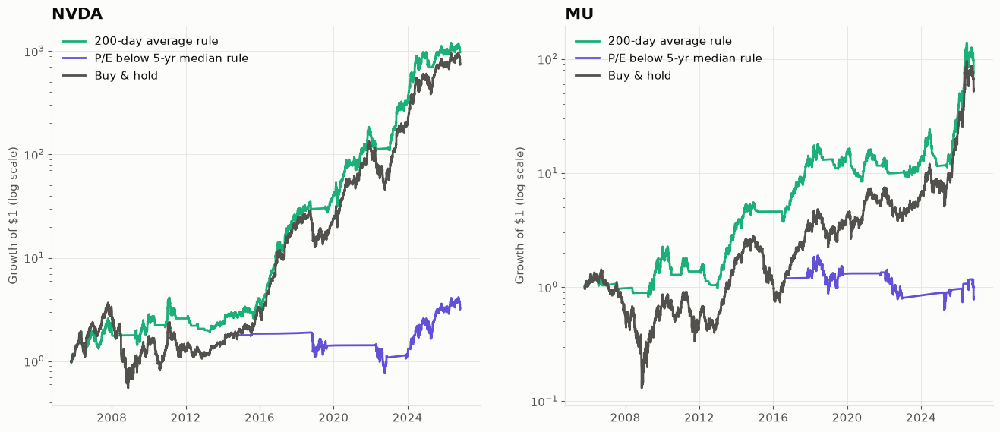
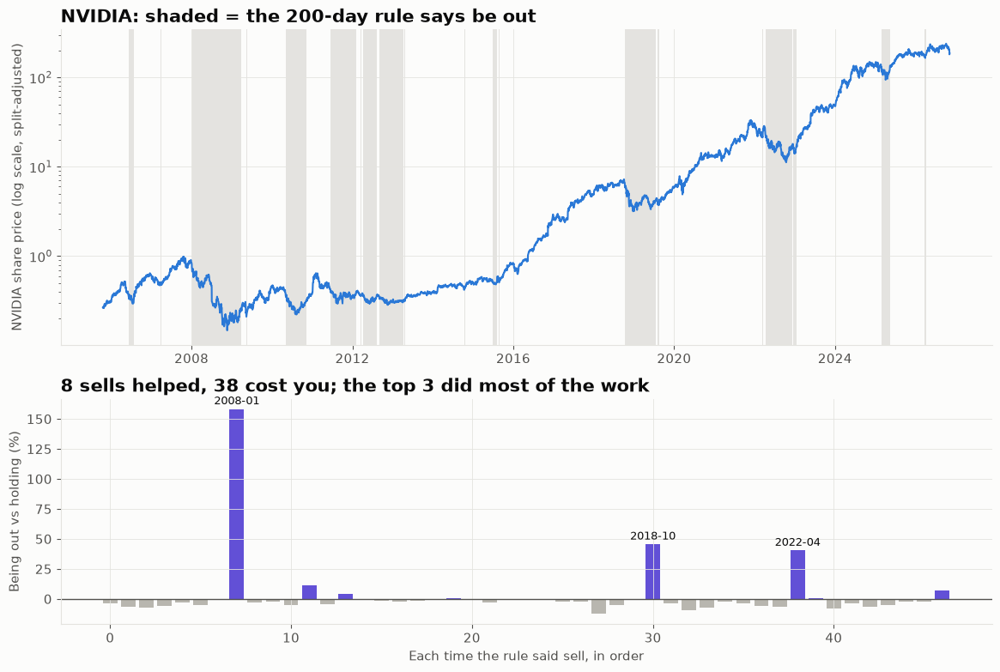
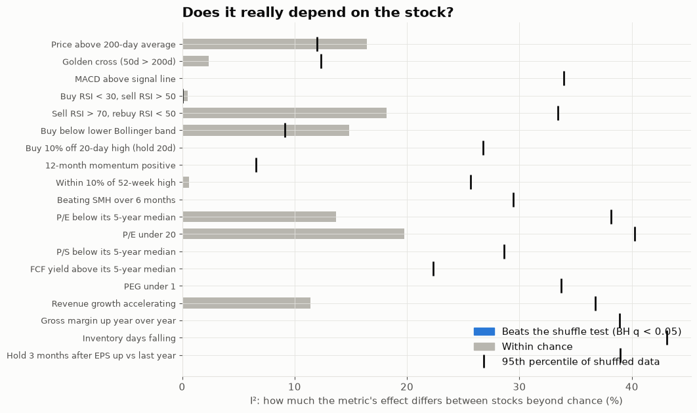
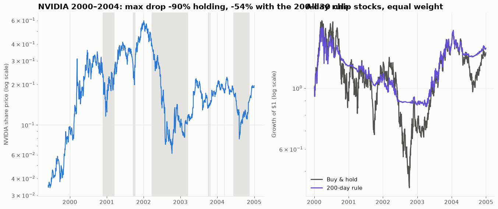

# Does any indicator work on NVIDIA? 19 popular rules on 52 chip stocks

Code and results for my video **NVIDIA Broke Its 200-Day Moving Average. I Checked the Last 46 Times** (link coming when it's live).

On Nov 5, 2026, NVIDIA closed below its 200-day moving average, the classic sell signal. A few days later its RSI was the most oversold since 2019, the classic buy signal. So I took 19 indicators that traders and investors actually use (200-day average, golden cross, MACD, RSI, Bollinger bands, P/E, PEG, free cash flow yield and so on), turned each one into a rule, and tested them on NVIDIA, Micron and 50 other US-listed chip, memory, equipment and hardware stocks from 2005 to Nov 6, 2026. Then I ran the 200-day rule on the dot-com crash, which the main test never saw, with the prediction written down first.

I'm a physician, not a quant. If you find a mistake, open an issue and I'll pin the correction under the video.

## What I found

| | Rule | Hold |
| --- | --- | --- |
| NVIDIA, 200-day rule, Oct 2005 to Nov 2026: return per year | 38.7% | 37.1% |
| Worst drop | −54% | −85% |
| Sharpe ratio | 1.02 | 0.86 |
| Average chip stock (equal weight), 200-day rule: return per year | 12.2% | 21.8% |
| Worst drop | −29% | −66% |
| Sharpe ratio | 0.62 | 0.72 |
| Dot-com crash 2000–2004 (out of sample), equal weight: worst drop | −49% | −75% |
| Sharpe ratio | 0.29 | 0.32 |

- **The 200-day rule is crash insurance.** On NVIDIA it said sell 46 times; 38 of those cost money (median 4 trading days out, bought back higher 83% of the time). Three sells (Jan 2008, Oct 2018, Apr 2022) did nearly all the work. It beat holding in 5 of 22 years, and at a 100-day lookback it loses to holding.
- **For NVIDIA the timing did the protecting.** A fixed mix with the same average exposure (68% NVIDIA, the rest T-bills) still fell 75%.
- **The RSI buy rule (buy under 30, sell above 50)** kept you in NVIDIA 11% of the time and made 0.5% a year against 38.5% for holding.
- **"It depends on the stock" is mostly noise.** For all 19 indicators, the spread of results across stocks looked like what shuffled data gives (I² 0–20%, none survives Benjamini–Hochberg). NVIDIA's best rule has p = 0.019 alone and p = 0.29 after correcting for picking the best of 19 (Westfall–Young). Picking each stock's best rule before 2016 and holding it after beat buy & hold for 25% of 44 stocks.
- **The one pre-registered "it depends" that held:** valuation signals backfire for memory stocks (MU, WDC, STX): −30.0%/yr vs +9.9%/yr for the rest, exact permutation p = 0.001. Micron is at a P/E of 9.3 with a record 81% gross margin (checked against its FY2026 earnings release).
- **Dot-com, out of sample:** prediction 1 (the rule cuts drawdowns) held for 26 of 30 stocks. Prediction 2 (it beats holding on Sharpe) didn't: 16 of 30, a coin flip.
- Results hold with one extra day of execution delay.

Full numbers: `results/recording_brief.txt`. Every table the notebook writes is in `results/`.

## Figures

| | |
| --- | --- |
|  |  |
|  |  |

## How it works

- **Universe:** 52 US-listed semiconductor, memory/storage, equipment and hardware stocks (Qorvo dropped: acquired by Skyworks Oct 5, 2026, no free price history). NVIDIA and Micron are highlighted, not the whole sample.
- **Rules:** own the stock when the indicator is ON, hold 3-month T-bills when it's OFF. 10 bps per switch. Signals use the day's close; the position earns the next day's return. Fundamentals count only from the trading day after the SEC filing.
- **Effect per stock × indicator:** extra annual return on ON days vs OFF days, Newey–West errors (20 lags).
- **Does it work at all / does it depend on the stock:** random-effects pooling across stocks, and Cochran's Q / I² against 999 circular shifts of the whole return panel (keeps autocorrelation and cross-stock correlation). Benjamini–Hochberg across the 19.
- **Strategy level:** CAGR, Sharpe, max drawdown, timing alpha vs holding the same stock, Sharpe differences with a stationary block bootstrap.
- **Extra checks:** shrinkage toward the pooled estimate, best-of-19 vs random timing, walk-forward pooled vs per-stock models, year-by-year, lookback sensitivity, trading costs, one day of delay, timing vs a fixed stock/T-bill mix, every sell episode, 12- and 36-month valuation tests, and the 2000–2004 out-of-sample test.

## Run it

```
pip install -r requirements.txt
```

Open `nvidia_micron_indicators.ipynb`, put your name and email in `SEC_USER_AGENT` in the config cell (the SEC asks every script to identify itself), and run all. The first run downloads about 80 price histories and the SEC company facts, and takes 10–20 minutes, mostly the shuffle tests. Later runs use the cache in `cache_metrics/`.

Prices come from Yahoo Finance through `yfinance`, so they aren't in this repo; the notebook rebuilds them. Fundamentals come from SEC EDGAR company facts, T-bills from FRED (DTB3).

## Limits

- Survivors only. Chip companies that went bust or were bought out aren't in free data, which makes buy & hold look better than it was. That biases the test against the timing rules.
- I picked NVIDIA and Micron after the fact.
- Part A (including the memory valuation test) was designed before I saw any results. Parts B–D are exploratory, except the dot-com prediction, which was written down before running.
- No taxes. 46 sells in 20 years would cost real money in a taxable account.
- SEC company facts can lag a quarter (SMTC was stale on this run), and Q4 values are annual minus nine months.

For education only. Not financial advice.

## License

MIT. See `LICENSE`.
